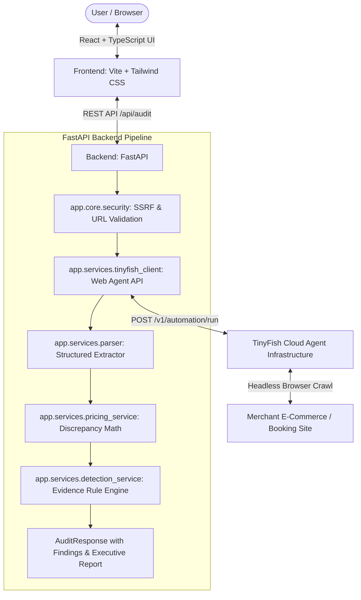

# 🔍 TinySleuth — AI-Powered Checkout Truth Auditor

> **Know the Real Price Before You Pay.**

TinySleuth is an evidence-based pricing transparency application. It uses a headless **TinyFish autonomous web agent** to inspect e-commerce shopping and travel booking checkout flows, extracting advertised base prices, unmasking drip pricing (platform convenience fees, surprise taxes, and handling surcharges), flagging pre-selected add-ons, and calculating mathematical price discrepancies.

---

## 🏛️ System Architecture



---

## 🚀 Key Features

1. **Autonomous Web Agent Inspection:**
   - TinyFish AI web agent loads destination product pages and progresses through guest checkout without human intervention.
   - Strictly non-destructive: **never enters credit card details, never submits orders, and halts before login/OTP steps**.

2. **Mathematical Pricing Discrepancy Engine:**
   - Calculates mathematical totals distinguishing extracted amounts from derived figures:
     $$\text{Expected Total} = \text{Initial Price } (I) + \text{Mandatory Charges } (M) + \text{Optional Selected Add-ons } (O)$$
     $$\text{Price Difference} = \text{Final Displayed Total } (F) - \text{Initial Price } (I)$$
   - Discrepancy analysis flags unitemized surcharges whenever $F \neq \text{Expected Total}$.

3. **Evidence-Based Dark Pattern Detection:**
   - Detects pre-checked optional add-ons (insurance, donations, express packaging) without explicit consumer opt-in.
   - Identifies undisclosed platform convenience fees and surprise booking taxes.
   - Flags high markup thresholds (>15% surcharge) with direct verbatim DOM quotes.

4. **Stripe / Linear-Inspired SaaS Interface (Light Theme):**
   - Clean, professional design with responsive tables, severity badges (`Potential Concern`, `Needs Review`, `Informational`), executive summary, and legal disclaimers.
   - Built-in **Demo Evaluation Scenarios** for offline and hackathon demonstration.

5. **Defense-in-Depth SSRF Security:**
   - Validates URLs against private IP subnets (`10.0.0.0/8`, `172.16.0.0/12`, `192.168.0.0/16`), loopbacks (`127.0.0.1`, `localhost`), and cloud metadata services (`169.254.169.254`, `metadata.google.internal`).

---

## 📂 Project Structure

```
tinysleuth/
├── backend/
│   ├── app/
│   │   ├── api/
│   │   │   └── routes.py              # GET /health, POST /audit
│   │   ├── core/
│   │   │   ├── config.py              # Environment configuration
│   │   │   └── security.py            # SSRF defense & URL validator
│   │   ├── models/
│   │   │   └── schemas.py             # Pydantic v2 data models
│   │   └── services/
│   │       ├── detection_service.py   # Evidence rule engine
│   │       ├── parser.py              # JSON & numeric extractor
│   │       ├── pricing_service.py     # Discrepancy math & deduplication
│   │       └── tinyfish_client.py     # TinyFish Agent API client
│   ├── tests/
│   │   ├── test_detection_service.py  # Rule engine unit tests
│   │   ├── test_parser.py             # Parser tests
│   │   ├── test_pricing_service.py    # Math calculation tests
│   │   ├── test_routes.py             # Mocked API endpoint tests
│   │   └── test_security.py           # SSRF security tests
│   ├── requirements.txt
│   ├── .env.example
│   └── .env                           # Local secrets (git-ignored)
│
├── frontend/
│   ├── src/
│   │   ├── api.ts                     # Typed API client
│   │   ├── App.tsx                    # Light SaaS dashboard
│   │   ├── index.css                  # Tailwind styles
│   │   └── main.tsx
│   ├── package.json
│   ├── tsconfig.json
│   └── vite.config.ts
│
├── scripts/
│   └── tinyfish_poc.py                # Standalone CLI audit tool
├── README.md
└── .gitignore
```

---

## 🛠️ Prerequisites

- **Python:** 3.10 or higher (Python 3.13 tested)
- **Node.js:** v18 or higher (Node v22 tested)
- **TinyFish API Key:** Get a key from [agent.tinyfish.ai](https://agent.tinyfish.ai/api-keys)

---

## ⚙️ Setup & Startup Guide

### 1. Backend Setup (Terminal 1)

In PowerShell:

```powershell
# Navigate to backend
cd backend

# Create & activate virtual environment
python -m venv .venv
.\.venv\Scripts\Activate.ps1

# Install dependencies
pip install -r requirements.txt

# Configure environment variables
# Copy .env.example to .env and insert your real TinyFish API key:
cp .env.example .env

# Start FastAPI development server
uvicorn app.main:app --reload --port 8000
```

Verify backend health: [http://localhost:8000/api/health](http://localhost:8000/api/health)

---

### 2. Frontend Setup (Terminal 2)

Open a second PowerShell window:

```powershell
# Navigate to frontend
cd frontend

# Install Node dependencies
npm install

# Start Vite dev server
npm run dev
```

Open your browser at: **[http://localhost:5173](http://localhost:5173)**

---

## 🧪 Testing

### Backend Automated Test Suite (25 Tests)

Run the full pytest suite from the `backend/` directory:

```powershell
cd backend
.\.venv\Scripts\Activate.ps1
pytest -v
```

All 25 tests verify:
- ✅ SSRF rejection (localhost, AWS/GCP metadata, private IPs)
- ✅ Pricing calculations (mandatory, optional pre-selected, discrepancies)
- ✅ Deduplication of identical line items
- ✅ Evidence detection rules & dark pattern alerts
- ✅ Mocked end-to-end API route execution

### Frontend Production Build Check

```powershell
cd frontend
npm run build
```

---

## 💻 Standalone CLI Audit Tool

To run an audit directly in the terminal without opening a browser:

```powershell
cd backend
.\.venv\Scripts\Activate.ps1
python ..\scripts\tinyfish_poc.py "https://example.com/product"
```

---

## 📡 API Reference

### `GET /api/health`
Returns system status and timestamp.
```json
{
  "status": "ok",
  "app": "TinySleuth",
  "service": "checkout_truth_auditor",
  "timestamp": "2026-11-01T07:30:00Z"
}
```

### `POST /api/audit`
Initiates an evidence-based checkout audit.

**Request Body:**
```json
{
  "url": "https://merchant.com/product/123"
}
```

**Response Body:**
```json
{
  "audit_id": "audit_849204820194",
  "url": "https://merchant.com/product/123",
  "status": "completed",
  "created_at": "2026-11-01T07:30:00Z",
  "completed_at": "2026-11-01T07:30:45Z",
  "product_title": "Example Product",
  "currency": "INR",
  "pricing_summary": {
    "initial_price": 1000.0,
    "final_displayed_total": 1250.0,
    "mandatory_charges_total": 150.0,
    "optional_selected_charges_total": 100.0,
    "expected_total": 1250.0,
    "price_difference": 250.0,
    "percentage_increase": 25.0,
    "data_completeness": "complete"
  },
  "findings": [
    {
      "id": "find_preselected_0",
      "category": "preselected_addon",
      "title": "Pre-selected Optional Add-on: Express Delivery Protection",
      "severity": "potential_concern",
      "explanation": "Optional item was pre-selected by default.",
      "evidence": "Checkbox checked: Add Express Care (₹100)",
      "confidence": "high",
      "suggested_action": "Deselect item before final payment."
    }
  ],
  "summary_report": "TinySleuth audited the checkout flow..."
}
```

---

## 🔒 Security & Privacy Notice

- **API Keys:** The TinyFish API key is stored strictly on the server in `backend/.env`. It is never delivered to the client browser.
- **SSRF Defense:** User-supplied URLs are validated against private IP ranges and cloud metadata endpoints prior to external dispatch.
- **Consumer Privacy:** TinySleuth enforces non-destructive guest browsing. The agent halts before payment gateways, OTP prompts, or login authentication.
